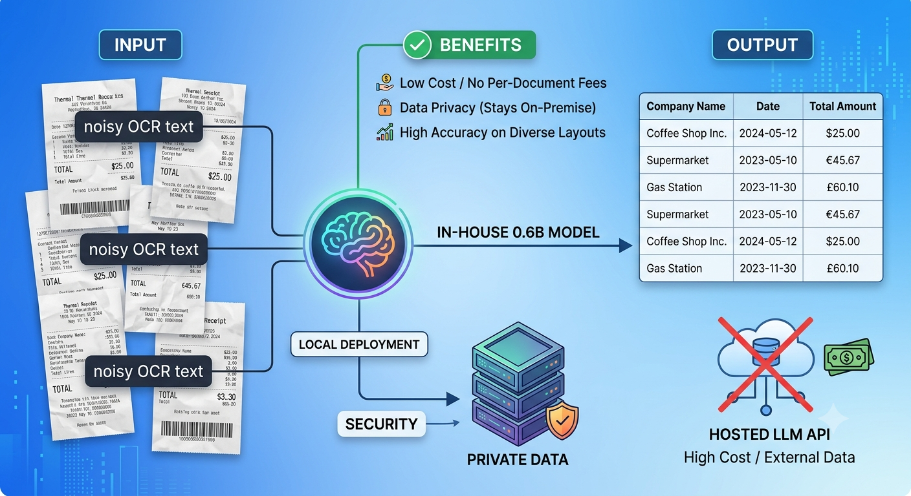

# Receipt field extraction with a LoRA-tuned small LM

**Ganesh Patil | Track B (SLM fine-tuning) | Scenario S2: Gen AI for enterprise documents**
Repo: github.com/ai-pp-2025/avathon-slm-doc-extraction | All numbers: `results/summary.md`, `runs/*/run_info.json`

## 1. Problem and domain

**Problem.** Accounts-payable and expense teams receive receipts as noisy OCR text and need `company`, `date` and `total` as structured fields. Rules break on layout variety (several "TOTAL" lines, many date formats), and a hosted LLM API adds per-document cost and sends financial documents outside the company. A 0.6B model that runs in-house is the target.

**Why Track B.** The base model does not lack knowledge; it lacks task behaviour: which of several amounts is the total, copying the date string exactly, emitting only the JSON. That is a behaviour change, so it belongs in weights, not a prompt. RAG adds nothing because the answer is in the single document already in context.

**Data.** SROIE (`jsdnrs/ICDAR2019-SROIE`, CC-BY-4.0): 551 train, 75 validation, 361 held-out test receipts. Validation is split **by merchant** (SROIE repeats merchants, so a random split leaks). Test is the official split, scored overall and on the 125 receipts whose merchant never appears in training. `address` is excluded: in this dataset conversion OCR lines are cut at the first comma, so 504 of 551 gold addresses are not in the text; training on them would teach guessing.

## 2. Approach and algorithm decisions

| Decision | Chosen | Alternatives | Why / evidence |
|---|---|---|---|
| Adapt vs prompt vs rules | LoRA fine-tune | zero-shot, 3-shot (same model), regex | all3 EM (company, date and total all correct): 37.1% zero-shot, 46.5% regex, 54.0% 3-shot, **88.1%** tuned. Zero-shot fails on format (date 63.7%: often appends the time or returns a phone number). Regex is strong on dates (95.0%) but weak on company and total. |
| Base model | Qwen3-0.6B | Qwen3-1.7B, Qwen2.5-0.5B, SmolLM2-1.7B | Chosen for the free T4 budget: 7.4 GB peak, 35 min for the final run, 38.5 MB adapter. Alternatives were **not trained** (time), so this is a cost-based choice, not an empirical one. |
| PEFT method | LoRA | QLoRA, full fine-tune | At n=100, QLoRA matches LoRA (74.2% vs 74.5% all3) but saves no memory (6.49 vs 6.36 GB peak; activations and the 151k-vocab logits dominate at this size) and is slightly slower. Full fine-tuning not run: 606M trainable parameters for 551 examples, more forgetting risk, no need shown. |
| Rank | r=16, alpha=32 | r=4, r=64 | n=100, all3 / unseen: r4 70.1 / 46.4, **r16 74.5 / 52.0**, r64 74.2 / 58.4. r64 has a 4x larger adapter (154 MB vs 38.5 MB) and no overall gain; r4 loses ~4 points. |
| Target modules | all linear layers | attention only (q,k,v,o) | Attention-only r16 is 3.0 points lower (71.5% all3) with 4.6M vs 10.1M trainable parameters. |
| Training data | all 551 | 100, 300 | all3 / unseen: 74.5 / 52.0 (n=100), 85.0 / 68.8 (n=300), 88.1 / 73.6 (n=551). Still improving, with diminishing returns. |
| Decoding | greedy, stop at `}` | sampling, constrained JSON | All outputs of all runs parsed as JSON, so constrained decoding was unnecessary. |

Training: lr 2e-4 cosine, 3 epochs, loss on the JSON tokens only, best epoch by validation loss (0.0186), seed 42. Environment in `results/env_freeze.txt` (Colab T4, transformers 5.18, peft 0.21.1).

**Learned or memorised?** Seen merchants score 95.8% (n=236), unseen 73.6% (n=125): a 22-point gap, so part of the gain is merchant memorisation. Unseen merchants still beat every baseline by 33+ points (best baseline 40.0%), and unseen accuracy rises with data (52.0, 68.8, 73.6), which is what learning the task rather than the templates looks like.

## 3. Results and error analysis

Test set, n=361 (95% interval about ±3.4 points at 88%, ±7.7 on the unseen subset):

| run | n | JSON ok | company EM | company F1 | date EM | total EM | all3 EM | all3 EM (unseen merchants) | ungrounded | gold ungrounded | ms/receipt |
|---|---|---|---|---|---|---|---|---|---|---|---|
| qwen3-0.6b_3shot | 361 | 100.0% | 69.3% | 87.9% | 91.1% | 73.7% | 54.0% | 40.0% | 2.8% | 2.8% | 2350 |
| qwen3-0.6b_lora_attn_r16_n100 | 361 | 100.0% | 81.7% | 91.5% | 94.7% | 90.9% | 71.5% | 50.4% | 3.9% | 2.8% | 794 |
| **qwen3-0.6b_lora_r16** | **361** | **100.0%** | **93.4%** | **96.4%** | **98.3%** | **95.8%** | **88.1%** | **73.6%** | **0.0%** | **2.8%** | **789** |
| qwen3-0.6b_lora_r16_n100 | 361 | 100.0% | 83.9% | 91.0% | 96.4% | 91.4% | 74.5% | 52.0% | 1.1% | 2.8% | 808 |
| qwen3-0.6b_lora_r16_n300 | 361 | 100.0% | 92.2% | 96.1% | 97.0% | 94.5% | 85.0% | 68.8% | 0.3% | 2.8% | 789 |
| qwen3-0.6b_lora_r4_n100 | 361 | 100.0% | 81.4% | 90.8% | 93.9% | 87.5% | 70.1% | 46.4% | 3.0% | 2.8% | 792 |
| qwen3-0.6b_lora_r64_n100 | 361 | 100.0% | 84.2% | 91.0% | 95.6% | 91.4% | 74.2% | 58.4% | 0.8% | 2.8% | 795 |
| qwen3-0.6b_qlora_r16_n100 | 361 | 100.0% | 85.9% | 92.8% | 96.1% | 87.8% | 74.2% | 52.0% | 3.6% | 2.8% | 797 |
| qwen3-0.6b_zeroshot | 361 | 100.0% | 66.8% | 87.2% | 63.7% | 80.9% | 37.1% | 32.0% | 8.0% | 2.8% | 902 |
| regex | 361 | 100.0% | 64.0% | 90.7% | 95.0% | 71.7% | 46.5% | 35.2% | 0.0% | 2.8% | 0 |

"Ungrounded" = a predicted value that does not occur in the receipt text (hallucination proxy). The same check on the gold labels flags 2.8%, the noise floor.

**Qualitative (receipt X51005447842; gold date 14/03/2018, total 0.90).** Zero-shot: `"date": "016-5498845", "total": 5.00` (a phone number as the date, the subtotal as the total). 3-shot: right date, total 5.00. Tuned: `{"company": "PASARAYA BORONG PINTAR SDN BHD", "date": "14/03/2018", "total": "0.90"}`. On X51005230648 zero-shot returns `"date": "29/01/2018 4:40:40 PM"`; tuned returns the bare date.

**Where it fails.** 43 of 361 receipts have at least one wrong field: company 24, total 15, date 6. Ten of the 43 involve a gold label that is not in the OCR text, so some errors are label noise (for example gold "TED HENG STATIONERY" where the text says "TEO HENG"). Thirty-three of the 43 are on unseen merchants. Typical genuine errors: wrong entity ("SIMPLIFIED TAX INVOICE" taken as company), suffix mismatches ("S/B" or "666" dropped), totals off by rounding (7.40 vs 7.42) or taken from the wrong "TOTAL" line (263.02 vs 278.80), and dates with a wrong digit or a date range.

## 4. Production and limitations

**Production.** Serve the merged model in-house and gate every output with the grounding check: ungrounded values go to human review. Caveat: a wrong-but-present total (wrong line) passes this check, so add arithmetic checks (total vs line items) and a confidence threshold. Measured on a T4 with unoptimised HF generate: 0.79 s per receipt at batch 8, 3.0 s at batch 1 (50 receipts). Quantised or on-device latency was **not measured**.

**Limitations (not done; next steps).**
- No catastrophic-forgetting check was run (WikiText-2 perplexity code is in `forgetting.py` but was not executed), and no larger prompted model (7B) or other base model was tried.
- Ablations use 100 training examples with gradient accumulation 8; the final run uses all 551 with accumulation 4, so optimiser steps differ. One seed per configuration; rank and target differences of 3-4 points are within sampling noise, so r=16 all-linear is a reasonable default, not a proven optimum.
- One dataset (Malaysian English receipts), clean OCR text as input (no layout or image), `address` excluded.
